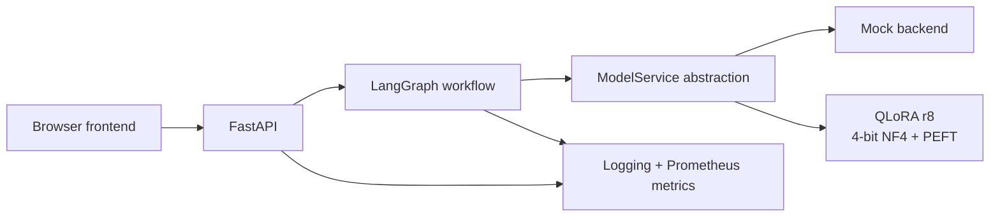

# LLM LoRA / QLoRA Fine-Tuning

Parameter-efficient adaptation of **Qwen2.5-7B** with QLoRA, empirical rank comparison, controlled inference benchmarking, and a production-oriented serving layer built with **FastAPI**, **LangGraph**, Prometheus-style metrics, tests, and a browser frontend.

> **Scope:** this is a hands-on portfolio / engineering project. It demonstrates end-to-end implementation and production-oriented practices, but it is not presented as long-term commercial production experience.

## Project highlights

- Base model: `Qwen/Qwen2.5-7B` (base, not instruction-tuned).
- Dataset: `databricks/databricks-dolly-15k`.
- QLoRA training: 4-bit NF4 base weights, BF16 compute, double quantization.
- LoRA targets: `q_proj`, `k_proj`, `v_proj`, `o_proj`.
- Rank comparison: **r=8** vs **r=16** under the same explicit hyperparameter configuration.
- Selected runtime adapter: **QLoRA r8** because it achieved almost the same validation loss as r16 with half the trainable LoRA parameters and a smaller artifact.
- Controlled inference comparison across 4-bit, BF16, dynamic PEFT, and merged BF16 modes.
- FastAPI service with health/readiness separation, structured schemas, lifecycle-based model loading, and environment-configurable runtime mode.
- Meaningful LangGraph workflow: generation -> output validation -> conditional routing.
- Lightweight observability: application logging plus `/metrics` counters/histograms.
- Unit, API, workflow, and **real GPU end-to-end** tests.
- Docker and Singularity definitions included as deployment-readiness artifacts.

## Architecture



The application layer is deliberately separated from the model implementation. `ModelService` makes it possible to switch between a lightweight mock backend and the real QLoRA GPU backend without coupling the API to a specific machine.

## Repository structure

```text
.
├── app/                    # FastAPI application, services, schemas, workflow
│   ├── api/
│   ├── core/
│   ├── schemas/
│   ├── services/
│   └── workflows/
├── configs/                # QLoRA r8 / r16 experiment configs
├── data/                   # Local raw + processed data (large artifacts ignored by Git)
├── docs/screenshots/       # Runtime and test evidence used in the report
├── frontend/               # Static browser UI
├── results/                # Training adapters, comparisons, benchmark JSONs
├── scripts/                # Data, training, evaluation, benchmark, merge utilities
├── slurm/                  # SLURM wrappers for the GPU cluster
├── src/                    # Installable package namespace
├── tests/                  # Workflow, API, and real GPU integration tests
├── Dockerfile
├── Singularity.def
├── pyproject.toml
├── requirements-lock.txt
└── cluster_environment.txt
```

Large model weights, datasets, virtual environments, checkpoints, secrets, and raw scheduler logs are intentionally excluded from normal Git history.

## Model and data

### Base model

`Qwen/Qwen2.5-7B`

Verified model characteristics used during the project:

| Property | Value |
|---|---:|
| Architecture | `Qwen2ForCausalLM` |
| Logical parameters | 7,615,616,512 |
| Layers | 28 |
| Hidden size | 3,584 |
| Attention heads | 28 |
| KV heads | 4 |
| Intermediate size | 18,944 |
| Base dtype | BF16 |

The base checkpoint is not instruction-tuned, which makes the effect of instruction adaptation easier to observe.

### Dataset

The project uses `databricks/databricks-dolly-15k` with the fields:

```text
instruction, context, response, category
```

Initial stratified split with seed 42:

| Split | Examples |
|---|---:|
| Train | 13,509 |
| Validation | 1,502 |

A maximum sequence length of 1,024 tokens was chosen after token-length analysis. Instead of truncating long examples, overlength examples were filtered to avoid removing potentially important context.

| Split | Before | After filtering | Removed |
|---|---:|---:|---:|
| Train | 13,509 | 13,334 | 175 (1.295%) |
| Validation | 1,502 | 1,471 | 31 (2.064%) |

Prompt-only tokens are masked from the training loss; response tokens plus EOS are supervised.

## LoRA / QLoRA design

For a base projection matrix `W`, LoRA introduces low-rank matrices `A` and `B` while keeping `W` frozen. The trainable parameter count for one adapted linear layer is proportional to:

```text
r * (in_features + out_features)
```

Target modules:

```text
q_proj, k_proj, v_proj, o_proj
```

Shared settings:

| Setting | Value |
|---|---:|
| LoRA dropout | 0.05 |
| Bias | none |
| alpha / r | 2 |
| Quantization | 4-bit NF4 |
| Compute dtype | BF16 |
| Double quantization | enabled |
| Max length | 1024 |
| Epochs | 1 |
| Per-device batch | 4 |
| Gradient accumulation | 4 |
| Effective batch | 16 |
| Learning rate | 2e-4 |
| Weight decay | 0 |
| Max grad norm | 1 |
| Gradient checkpointing | enabled |
| Warmup ratio | 0.03 |
| Seed | 42 |

Rank-specific settings:

| Variant | Rank | Alpha | Trainable params | % of logical base | Adapter size |
|---|---:|---:|---:|---:|---:|
| QLoRA r8 | 8 | 16 | 5,046,272 | 0.0663% | ~31 MB |
| QLoRA r16 | 16 | 32 | 10,092,544 | 0.1325% | ~50 MB |

The 4-bit base weights are frozen. Quantization makes the base model cheaper to keep in memory; it does **not** mean the 4-bit base weights themselves are trained.

## Training results

Training ran on an NVIDIA A30 24 GB GPU under SLURM.

| Metric | QLoRA r8 | QLoRA r16 |
|---|---:|---:|
| Train examples | 13,334 | 13,334 |
| Optimizer steps | 834 | 834 |
| Training time | 76.92 min | 77.23 min |
| Peak GPU allocated | 18.18 GiB | 18.25 GiB |
| Peak GPU reserved | 22.40 GiB | 22.72 GiB |
| Final adapter | `results/qlora_r8/final_adapter` | `results/qlora_r16/final_adapter` |

The training loop is explicit PyTorch rather than `Trainer`/TRL. It exposes forward pass, loss scaling for gradient accumulation, backward pass, gradient clipping, optimizer step, scheduler step, and adapter checkpointing directly.

### Memory evidence

- BF16 base load: ~14.19 GiB allocated.
- 4-bit base load: ~5.18 GiB allocated.
- Loading-only reduction: ~9.01 GiB / ~63.5%.
- QLoRA smoke training: 8.81 GiB peak allocated.
- Comparable BF16 LoRA smoke training: 15.52 GiB peak allocated.
- Smoke-training memory reduction: ~43.2%.

These figures are hardware- and implementation-specific; they are not universal QLoRA guarantees.

## Validation

Validation set: **1,471 examples**.

| Model | Validation loss | Perplexity | Change vs base |
|---|---:|---:|---:|
| Base | 1.654063 | 5.2282 | - |
| QLoRA r8 | 1.592670 | 4.9169 | -3.71% loss |
| QLoRA r16 | 1.591850 | 4.9128 | -3.76% loss |

The loss difference between r8 and r16 is only **0.000820**. r16 is numerically slightly better on this validation metric, but the improvement is very small relative to the doubled LoRA parameter count.

## Qualitative comparison

`results/generation_comparison/base_vs_r8_vs_r16.jsonl` contains the original local artifact with 24 deterministic examples across eight Dolly categories. A GitHub-safe copy is included at `docs/results/base_vs_r8_vs_r16.jsonl`.

Observed pattern in this sample:

- The base model produced extra `### Instruction` / `### Response` continuations in 5/24 examples.
- r8 and r16 produced this formatting failure in 0/24 examples.
- Both QLoRA variants improved instruction-following / response-format behavior.
- Some individual tasks still regressed relative to the base model.
- r16 showed more repetitive degeneration in several inspected examples.

The selected runtime adapter is therefore **QLoRA r8** for this project. This is a project-specific engineering choice, not a claim that r8 is generally superior to r16.

## Controlled inference benchmarks

The benchmark uses the same 24 prompts, deterministic generation, and exactly 128 generated tokens per prompt (3,072 generated tokens per mode).

| Runtime mode | Mean latency | P95 | Throughput | Peak VRAM |
|---|---:|---:|---:|---:|
| Base 4-bit | 3.7256 s | 3.7656 s | 34.357 tok/s | 5.3837 GiB |
| QLoRA r8, 4-bit + PEFT | 6.1402 s | 6.2051 s | 20.846 tok/s | 5.3993 GiB |
| Base BF16 | 2.9426 s | 2.9782 s | 43.499 tok/s | 14.2712 GiB |
| BF16 + PEFT | 4.3147 s | 4.3504 s | 29.6659 tok/s | 14.2892 GiB |
| Merged BF16 | 2.9356 s | 2.9677 s | 43.6031 tok/s | 14.3464 GiB |

Key observations on the A30 used here:

1. 4-bit significantly reduces VRAM, but it is not automatically faster.
2. BF16 base inference was faster than 4-bit base inference.
3. Keeping a PEFT adapter active adds measurable runtime overhead.
4. Merging in BF16 recovered approximately native BF16-base throughput.
5. The deployment choice therefore depends on the memory budget versus throughput requirements.

## Merge behavior

Both 4-bit and BF16 merge smoke tests completed technically, but generated text was not bit-exact before versus after merge.

For the BF16 comparison, the immediate next-token argmax remained the same while small logit differences were present:

```text
max absolute logit difference: 0.25
mean absolute logit difference: 0.0278659
same next-token argmax: True
```

Autoregressive decoding can amplify small finite-precision differences later in a sequence, so this project does **not** claim bit-exact generation equivalence after merge.

## Serving application

### Runtime modes

`MODEL_MODE` controls the backend implementation:

```text
mock
qlora_4bit_peft
```

Key environment variables:

```text
APP_NAME
APP_VERSION
MODEL_MODE
MODEL_PATH
ADAPTER_PATH
MAX_NEW_TOKENS
```

The real QLoRA runtime loads the base model locally in 4-bit NF4 with BF16 compute, attaches the r8 PEFT adapter, and uses deterministic generation (`do_sample=False`).

### API endpoints

| Endpoint | Purpose |
|---|---|
| `GET /health` | Process-level liveness |
| `GET /ready` | Application/model workflow readiness |
| `GET /model-info` | Model, adapter, and runtime mode |
| `POST /generate` | Instruction/context generation |
| `GET /metrics` | Prometheus exposition format |

Request schema:

```json
{
  "instruction": "Explain overfitting and underfitting.",
  "context": ""
}
```

Response schema:

```json
{
  "text": "...",
  "model_mode": "qlora_4bit_peft",
  "latency_seconds": 2.77,
  "generated_tokens": 59
}
```

The FastAPI lifespan initializes the selected `ModelService` and compiles the LangGraph workflow at startup rather than loading the model as an import side effect.

## LangGraph workflow

The graph is intentionally small but functional:

```text
generate
   |
   v
validate_output
   |
   +---- non-empty ----> END
   |
   +---- empty --------> invalid_output -> error
```

This gives the application explicit workflow state, nodes, edges, and conditional routing rather than using LangGraph as a decorative wrapper.

## Frontend

The static frontend provides:

- API online/readiness status;
- model / adapter information;
- instruction input;
- optional context input;
- generated response;
- latency;
- generated-token count;
- runtime mode.

Start it locally with:

```bash
python -m http.server 8050 --bind 127.0.0.1 --directory frontend
```

Then open `http://127.0.0.1:8050/`.

## Run the API

Create and activate a Python 3.11 environment, then install the project dependencies. `requirements-lock.txt` is the exact validated environment snapshot; `pyproject.toml` defines the direct project dependencies.

Mock mode:

```bash
MODEL_MODE=mock \
python -m uvicorn app.main:app --host 127.0.0.1 --port 8040
```

Real QLoRA GPU mode:

```bash
MODEL_MODE=qlora_4bit_peft \
MODEL_PATH=data/raw/models/Qwen2.5-7B \
ADAPTER_PATH=results/qlora_r8/final_adapter \
python -m uvicorn app.main:app --host 127.0.0.1 --port 8040
```

The real mode requires CUDA and access to the base model plus adapter artifacts.

## Training

The training entry point accepts a YAML configuration:

```bash
python scripts/train_qlora.py --config configs/qlora_r8.yaml
```

For the r16 comparison:

```bash
python scripts/train_qlora.py --config configs/qlora_r16.yaml
```

The repository also contains matching SLURM wrappers for cluster execution and separate scripts for data inspection, overlength analysis, tokenization, validation, generation comparison, merge checks, and inference benchmarking.

## Tests

Lightweight tests run in mock mode without loading the 7B checkpoint:

```bash
python -m unittest \
  tests/test_generation_graph.py \
  tests/test_api_workflow.py \
  -v
```

The real GPU API test is opt-in:

```bash
RUN_GPU_INTEGRATION=1 python -m unittest \
  tests/test_generation_graph.py \
  tests/test_api_workflow.py \
  tests/test_real_gpu_api.py \
  -v
```

Final cluster validation: **6 tests passed**, including a real `POST /generate` call through the running QLoRA GPU API.

## Observability

Application logging records successful inference events with runtime mode, latency, and generated-token count.

Prometheus-style metrics include:

```text
llm_requests_total{model_mode,status}
llm_inference_latency_seconds{model_mode}
llm_generated_tokens_total{model_mode}
```

A validated real-GPU request incremented the success counter, observed ~2.77 s inference latency, and recorded 59 generated tokens.

## Containerization

A backend `Dockerfile` and `Singularity.def` are included.

Example mock-mode Docker workflow:

```bash
docker build -t lora-qlora-api .
docker run --rm -p 8040:8040 -e MODEL_MODE=mock lora-qlora-api
```

For real GPU inference, the model and adapter should be mounted as external artifacts rather than baked into the image, and a compatible GPU container runtime is required.

Container validation status is documented precisely:

- Docker was not available on the university cluster, so the Docker image was not built there.
- Singularity CE 4.3.2 was available, but local `--fakeroot` build was blocked by missing user mapping.
- Remote Singularity build required external authentication and was intentionally not configured.
- Final Docker build/run validation is therefore deferred to the local Windows environment.

## Reproducibility notes

Validated environment includes:

| Component | Version / value |
|---|---|
| Python | 3.11.11 |
| PyTorch | 2.11.0+cu128 |
| Transformers | 5.17.0 |
| Datasets | 5.0.1 |
| Accelerate | 1.15.0 |
| PEFT | 0.21.0 |
| bitsandbytes | 0.50.2 |
| FastAPI | 0.141.1 |
| Uvicorn | 0.53.0 |
| LangGraph | 1.2.12 |
| prometheus-client | 0.26.0 |
| GPU | NVIDIA A30 24 GB |
| Scheduler | SLURM |

`pip check` completed with **no broken requirements** before the final environment lock was generated.

### Reproducibility boundaries

- CUDA training is not claimed to be bitwise deterministic.
- r8 and r16 share the same explicit hyperparameters, but exact stochastic sample ordering is not guaranteed to be bit-identical because the DataLoader relied on the global PyTorch RNG and LoRA initialization consumes RNG differently by rank.
- The final partial gradient-accumulation group is divided by the full accumulation factor in the existing training loop. This affects only the final optimizer step and was kept identical for both rank runs so the completed comparison was not silently changed after the fact.
- Large model/data artifacts must be restored or regenerated before real-model serving can run from a fresh clone.

## Main evidence

The illustrated technical report uses the real runtime evidence under `docs/screenshots/`, including:

- Swagger health/readiness/model-info endpoints;
- mock generation and schema validation;
- real QLoRA readiness and model metadata;
- real QLoRA generation response;
- LangGraph and API tests;
- browser frontend with real GPU inference;
- Prometheus metrics;
- lifecycle/readiness tests;
- complete six-test suite including real GPU end-to-end inference.

## Limitations

- One base model, one dataset, one GPU architecture, and two LoRA ranks were studied.
- Validation loss/perplexity and a small qualitative sample do not provide a complete task-quality evaluation.
- The API currently exposes a single generation path rather than a multi-tenant production serving stack.
- Metrics are intentionally lightweight; no external Prometheus/Grafana deployment is claimed.
- No long-term load, concurrency, autoscaling, authentication, rate limiting, or SLO validation is claimed.
- Docker configuration is present, but final image build/run validation is deferred to the local environment.
- Adapter artifacts and base-model weights are external large artifacts and are not intended for normal Git history.

## Technical report

See `technical_report.pdf` for the complete illustrated project report, including training design, rank comparison, memory analysis, benchmark results, serving architecture, frontend, tests, observability, containerization status, reproducibility boundaries, and screenshots of the validated runtime.
